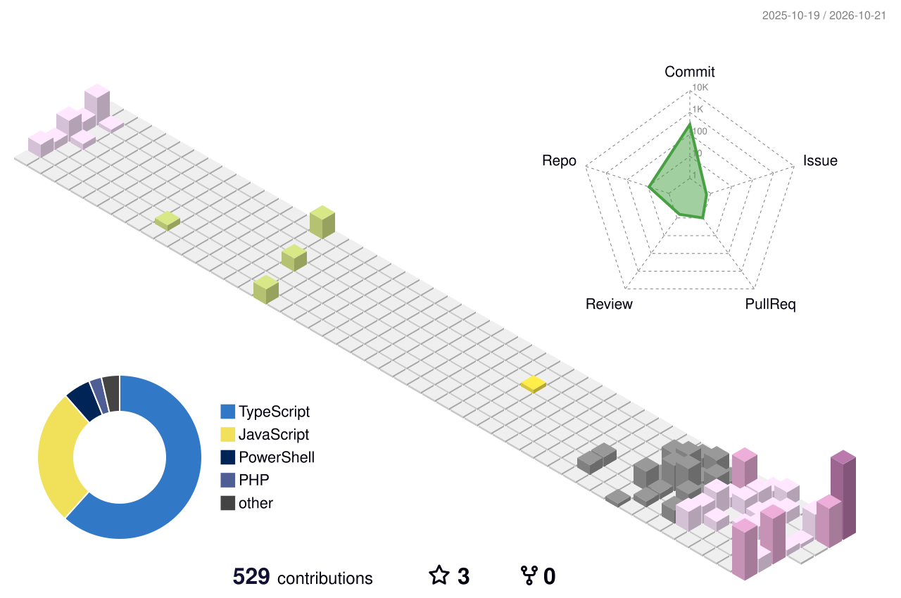

## Olá! 👋 Sou o Victor Gabriel

Desenvolvedor full-stack, graduado em Sistemas de Informação. Construo aplicações SaaS multi-tenant com Laravel e React + TypeScript, e hoje também trabalho com **NestJS** no back-end, **Next.js** na web e **React Native** no mobile.

O que mais me interessa é a parte que sustenta o produto: isolamento de dados por cliente, APIs bem documentadas, filas confiáveis e ambientes Docker que sobem igual em qualquer máquina.

### O que eu uso

- **Back-end:** Laravel (PHP), NestJS e Node.js
- **Front-end:** React, Next.js (App Router) e TypeScript
- **Mobile:** React Native
- **Dados:** MySQL, MariaDB, Redis
- **Infra:** Docker, nginx, Traefik, Vercel
- **Qualidade:** PHPUnit, OpenAPI, Conventional Commits, Git / GitHub

  
  
  
  
  
  
  
  
  
  

### Onde me encontrar

🌐 [Meu portfólio](https://victordev-portfolio.vercel.app/)

##

<!---->

